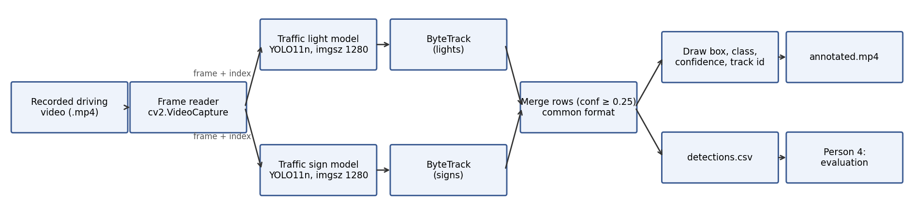

# Video processing, tracking and integration

Owner: Person 3. Reads a recorded driving video, runs the traffic light and traffic sign detectors on every frame, tracks the boxes with ByteTrack, and writes an annotated video and a CSV in the common detection format.

## Architecture




Each frame goes through both models one after the other. Each model keeps its own ByteTrack tracker. The rows of both models are concatenated, because the two models share no classes.

## Common detection format

One row per detected box in `detections.csv`:

| Field | Type | Meaning | Example |
|---|---|---|---|
| `frame_index` | int | 0 for the first frame of the video | `24` |
| `x1, y1, x2, y2` | float | `bbox_xyxy`: top-left and bottom-right corner, in pixels of the original frame | `915.0, 291.6, 957.7, 320.3` |
| `class_name` | str | From `model.names`. Lights: red, yellow, green, off. Signs: stop, yield, speed_limit, no_entry, priority_road, no_parking | `traffic light` |
| `confidence` | float | 0 to 1 | `0.2668` |
| `track_id` | int or empty | ByteTrack id. Empty when tracking is off or the box has no track yet | (empty) |
| `source` | str | Which model produced the box: `light`, `sign` or `coco`. Track ids are counted per model, so `(source, track_id)` identifies one object | `coco` |

The example is a real row from `results/video_pipeline/baseline_detect/detections.csv` (COCO model, detection only).

Fixed settings: `imgsz=1280`, `conf=0.25`.

## Sample video

| | |
|---|---|
| File | `datasets/videos/sample_drive.mp4` (not in git) |
| Source | [City Driving 4K- Kraków Poland 2024](https://commons.wikimedia.org/wiki/File:City_Driving_4K-_Krak%C3%B3w_Poland_2024.webm), Wikimedia Commons, by Relaxing Roads 4K |
| Licence | CC BY 3.0 (reuse allowed with attribution) |
| Part used | 58–78 s of the 1080p transcode, scaled to 1280×720, 30 fps, H.264, no audio |
| Info | 1280×720, 30 fps, 600 frames, 20 s (`results/video_pipeline/video_info.txt`) |

To rebuild it (the first 100 MB of the transcode cover the first two minutes):

```bash
mkdir -p datasets/videos/raw
curl -r 0-99999999 -o datasets/videos/raw/krakow_1080p_head.webm "https://upload.wikimedia.org/wikipedia/commons/transcoded/9/98/City_Driving_4K-_Krak%C3%B3w_Poland_2024.webm/City_Driving_4K-_Krak%C3%B3w_Poland_2024.webm.1080p.vp9.webm"
ffmpeg -ss 58 -t 20 -i datasets/videos/raw/krakow_1080p_head.webm -an -vf "fps=30,scale=1280:-2" -c:v libx264 -crf 18 -pix_fmt yuv420p datasets/videos/sample_drive.mp4
```

## How to run

From the repo root, with Python 3.10 and `pip install -r requirements.txt`:

```bash
python src/video_pipeline/test_pipeline.py      # self-checks, no weights or video needed
python src/video_pipeline/video_info.py --video datasets/videos/sample_drive.mp4
python src/video_pipeline/video_processing.py --video datasets/videos/sample_drive.mp4 --baseline --name baseline_detect
```

Weights go in `models/` (ignored by git): `traffic_lights_y11n_1280_best.pt` from Person 1's [Drive link](https://drive.google.com/file/d/1XzQtAnm4rvAYFkEH2tfSxi2aus6NLnha/view?usp=sharing), `traffic_signs_y11n_1280.pt` from the GitHub Release `signs-y11n-1280-v1`.

OpenCV writes `annotated.mp4` with the mp4v codec (about 50 MB for 20 s, and browsers cannot play it), so it is not in git. The committed copy is made with:

```bash
ffmpeg -i results/video_pipeline/<name>/annotated.mp4 -c:v libx264 -crf 28 -pix_fmt yuv420p results/video_pipeline/<name>/annotated_small.mp4
```

Tracking runs:

```bash
python src/video_pipeline/video_processing.py --video datasets/videos/sample_drive.mp4 --baseline --track --name baseline_track
python src/video_pipeline/video_processing.py --video datasets/videos/sample_drive.mp4 --track --name finetuned_track
```

## Tracking observations

From `results/video_pipeline/baseline_track/` and `finetuned_track/` on the 20 s test clip (600 frames). Frame numbers are `frame_index`.

- **Signs are tracked well.** A yield sign keeps id 20 from frame 105 to 207 (93 rows), a closer yield sign keeps id 41 from 284 to 339, and a far no_entry sign of about 10 px keeps id 51 from 362 to 584 even though it has no row at conf ≥ 0.25 in 55 of those frames (longest gap 23 frames). ByteTrack's low-score pass (conf 0.1–0.25) and its 30-frame buffer for lost tracks bridge these gaps.
- **Lost and back with a new id.** The yield track 20 ends at frame 207 and track 41 starts at 284. The gap (77 frames) is longer than ByteTrack's 30-frame buffer, so if this is the same sign it comes back with a new id. Without labels I cannot say for sure.
- **Tiny objects rarely get an id.** Speed limit signs of 10–12 px produce single-frame tracks (ids 8, 54) or a track with more gaps than hits (id 62: 5 hits over 32 frames).
- **Lights are the weak part on this clip.** The light model gives only 17 rows (11 red, 6 green), and only one becomes a track (id 56, frames 412–413). The light model was trained on US footage (Bosch), and Polish lights look different, so this is mostly a domain gap and not a tracking problem.
- **No class flicker inside a track.** No track changes its class in either run, so the majority-vote smoothing that Person 1 suggested has nothing to fix on this clip yet.
- **Untracked rows.** 54 of 381 rows in `finetuned_track` and 104 of 123 in `baseline_track` have no id. These are frames where the tracker has no confirmed track at all, and then Ultralytics returns the raw detections. The COCO model's scores sit close to 0.25 and flicker, so its tracks are rarely confirmed.
- **Track mode changes the boxes.** In track mode the boxes are ByteTrack's smoothed boxes, and an object's first frame can be missing, so `baseline_track` (123 rows) and `baseline_detect` (124 rows) do not match box for box.
- **False positives.** The COCO model calls a red oval shop sign a stop sign (frame 2). The sign model reports one `stop` row, and there is no stop sign in the clip.

## Integration plan

How the two detection modules are called and combined (code: `video_processing.py`):

1. **Calling the models.** Both are YOLO11n `.pt` files loaded with `YOLO(path)`: lights from Person 1 (classes red, yellow, green, off) and signs from Person 2 (stop, yield, speed_limit, no_entry, priority_road, no_parking). Each frame goes to each model with `imgsz=1280`. Class names come from `model.names`, so nothing is hard-coded.
2. **Tracking.** Each model is called with `model.track(frame, conf=0.1, persist=True, tracker="bytetrack.yaml")`. Every model keeps its own tracker, and rows below conf 0.25 are dropped afterwards.
3. **Combining the boxes.** The rows of both models for a frame are concatenated, each tagged with `source`. There is no cross-model NMS because the class sets do not overlap.
4. **Output.** One annotated video and one `detections.csv` in the common format, plus `run_info.txt` with settings and speed.

Next stage:
- Evaluate on video with labels (Person 4). The Bosch test sequences have light labels; there is no labelled video for signs yet.
- A test clip with more traffic lights, ideally closer to the Bosch domain, to separate the domain gap from tracking problems.
- Majority-vote smoothing of the light colour per track (Person 1's suggestion), once a clip shows colour flicker inside a track.
- Run on the RTX 4070 machine to get speed numbers comparable with the teammates' GPU numbers.

## Implementation status

| Item | Status | Evidence |
|---|---|---|
| Architecture diagram and shared fields | done | this README, `results/video_pipeline/architecture.png` |
| Sample video, info and sample frames | done | `results/video_pipeline/video_info.txt`, `sample_frames/` |
| Detection on video, COCO baseline | done | `results/video_pipeline/baseline_detect/` |
| Tracking with ids (ByteTrack) | done | `results/video_pipeline/baseline_track/` |
| Both fine-tuned models in one pipeline | done | `results/video_pipeline/finetuned_track/` |
| Speed | measured | MacBook, Apple M4 (MPS), 1280×720 at imgsz 1280: both models + tracking 21.0 FPS end to end (light 3.4 ms, sign 3.2 ms inference per frame); COCO baseline 35.4 FPS detect only, 34.3 FPS with tracking |
| Evaluation on labelled video | next stage | Person 4 |
| Colour smoothing per track | next stage | no flicker seen on the test clip |
