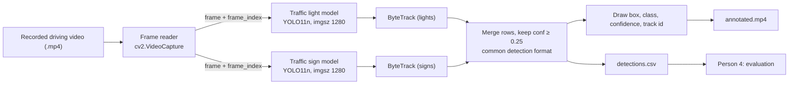

# Video processing, tracking and integration

Owner: Person 3. Reads a recorded driving video, runs the traffic light and traffic sign detectors on every frame, tracks the boxes with ByteTrack, and writes an annotated video and a CSV in the common detection format. Design decisions are recorded in [`adr/`](adr/README.md).

## Architecture




Each frame goes through both models one after the other. Each model keeps its own ByteTrack tracker. The rows of both models are concatenated, because the two models share no classes ([ADR-0002](adr/0002-one-frame-loop-concatenate-models.md)).

## Common detection format

One row per detected box in `detections.csv` ([ADR-0003](adr/0003-detection-csv-format-with-source.md)):

| Field | Type | Meaning | Example |
|---|---|---|---|
| `frame_index` | int | 0 for the first frame of the video | `24` |
| `x1, y1, x2, y2` | float | `bbox_xyxy`: top-left and bottom-right corner, in pixels of the original frame | `915.0, 291.6, 957.7, 320.3` |
| `class_name` | str | From `model.names`. Lights: red, yellow, green, off. Signs: stop, yield, speed_limit, no_entry, priority_road, no_parking | `traffic light` |
| `confidence` | float | 0 to 1 | `0.2668` |
| `track_id` | int or empty | ByteTrack id. Empty when tracking is off or the box has no track yet | (empty) |
| `source` | str | Which model produced the box: `light`, `sign` or `coco`. Track ids are counted per model, so `(source, track_id)` identifies one object | `coco` |

The example is a real row from `results/video_pipeline/baseline_detect/detections.csv` (COCO model, detection only).

Fixed settings: `imgsz=1280`, `conf=0.25`.

## Sample video

| | |
|---|---|
| File | `datasets/videos/sample_drive.mp4` (not in git) |
| Source | [City Driving 4K- Kraków Poland 2024](https://commons.wikimedia.org/wiki/File:City_Driving_4K-_Krak%C3%B3w_Poland_2024.webm), Wikimedia Commons, by Relaxing Roads 4K |
| Licence | CC BY 3.0 (reuse allowed with attribution) |
| Part used | 58–78 s of the 1080p transcode, scaled to 1280×720, 30 fps, H.264, no audio |
| Info | 1280×720, 30 fps, 600 frames, 20 s (`results/video_pipeline/video_info.txt`) |

Why this clip: [ADR-0001](adr/0001-sample-video-krakow-cc-by.md). To rebuild it (the first 100 MB of the transcode cover the first two minutes):

```bash
mkdir -p datasets/videos/raw
curl -r 0-99999999 -o datasets/videos/raw/krakow_1080p_head.webm "https://upload.wikimedia.org/wikipedia/commons/transcoded/9/98/City_Driving_4K-_Krak%C3%B3w_Poland_2024.webm/City_Driving_4K-_Krak%C3%B3w_Poland_2024.webm.1080p.vp9.webm"
ffmpeg -ss 58 -t 20 -i datasets/videos/raw/krakow_1080p_head.webm -an -vf "fps=30,scale=1280:-2" -c:v libx264 -crf 18 -pix_fmt yuv420p datasets/videos/sample_drive.mp4
```

## How to run

From the repo root, with Python 3.10 and `pip install -r requirements.txt`:

```bash
python src/video_pipeline/test_pipeline.py      # self-checks, no weights or video needed
python src/video_pipeline/video_info.py --video datasets/videos/sample_drive.mp4
python src/video_pipeline/video_processing.py --video datasets/videos/sample_drive.mp4 --baseline --name baseline_detect
```

Weights go in `models/` (ignored by git): `traffic_lights_y11n_1280_best.pt` from Person 1's Drive link, `traffic_signs_y11n_1280.pt` from the GitHub Release `signs-y11n-1280-v1`.

OpenCV writes `annotated.mp4` with the mp4v codec (about 50 MB for 20 s, and browsers cannot play it), so it is not in git. The committed copy is made with:

```bash
ffmpeg -i results/video_pipeline/<name>/annotated.mp4 -c:v libx264 -crf 28 -pix_fmt yuv420p results/video_pipeline/<name>/annotated_small.mp4
```
